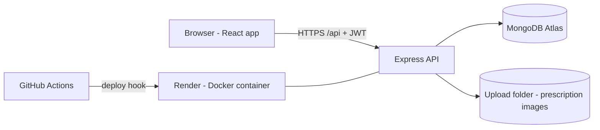
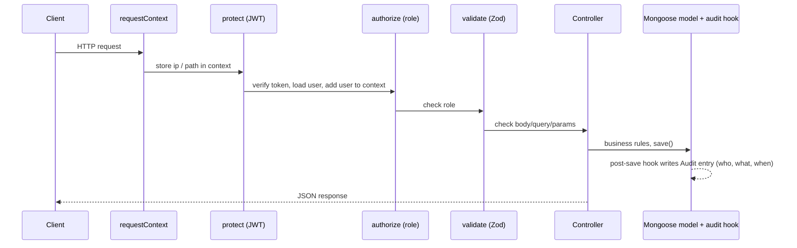
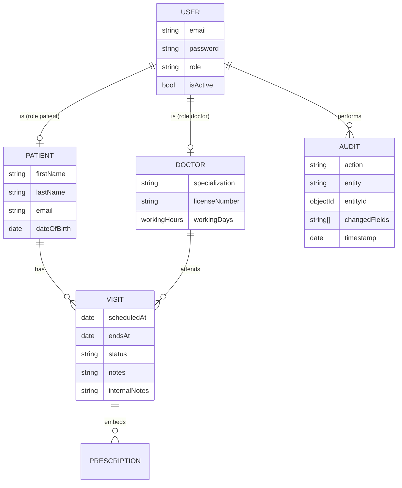

# Architecture

## System overview

In production **one container** runs the API and also serves the built React files, so there is a single Render service and no CORS trouble.

## Request flow

## Data model

Indexes: `Patient(email unique, lastName+firstName, phone)`, `Doctor(email unique, licenseNumber unique, specialization)`, `Visit(doctor+scheduledAt+endsAt, patient+scheduledAt, status+scheduledAt)`, `Audit(timestamp, user+timestamp, entity+entityId+timestamp, action+timestamp)`, `User(email unique, role)`.

## Key design decisions and trade-offs
| Decision | Why | Trade-off |
|---|---|---|
| Monorepo, one Docker image | Simple deploy on Render free tier | API and UI scale together |
| Audit via **Mongoose hooks** (+ AsyncLocalStorage for "who") | Impossible to forget in a controller; covers every `save`/`findOneAndUpdate`/`findOneAndDelete` | `updateOne`/`deleteMany`/`insertMany` bypass hooks — do not use them on audited models (the code base follows this rule) |
| Audit stores field **names** only | Audit log never becomes a second copy of private data | You cannot see *old/new values* |
| Audit collection is append-only in code | Tamper resistance | A DB admin can still edit it; for real compliance use DB-level permissions / WORM storage |
| Access token 15 min + rotating refresh token (hash stored) | Stolen access token expires quickly; refresh reuse is detected | One active session per user (new login replaces the refresh token) |
| Tokens kept in `localStorage` in the SPA | Simple | Exposed to XSS. Mitigated by Helmet CSP and no HTML injection; an httpOnly-cookie design is the upgrade path |
| Patients cannot be linked to an existing record by self-signup | Prevents claiming someone else's history by typing their email | Staff must link accounts for existing patients (Users page) |
| Slots computed from doctor's working hours, not stored | No stale slot rows | Each slot query reads that day's visits (indexed) |
| Clinic time zone by offset (`CLINIC_TZ_OFFSET_MINUTES`) | No extra dependency | No daylight-saving support (Pakistan has none today) |
| Prescription files on local disk | Zero cost, simple | **Render free disk is ephemeral** → move to S3/Cloudinary for production (see HANDOVER) |
| Report uses one `$group` aggregation, names looked up afterwards | Fast, uses the doctor/date index | Two queries instead of `$lookup` |
| Patient delete / doctor delete blocked when visits exist (409) | Medical records must not silently disappear | Use `isActive:false` for doctors instead |
